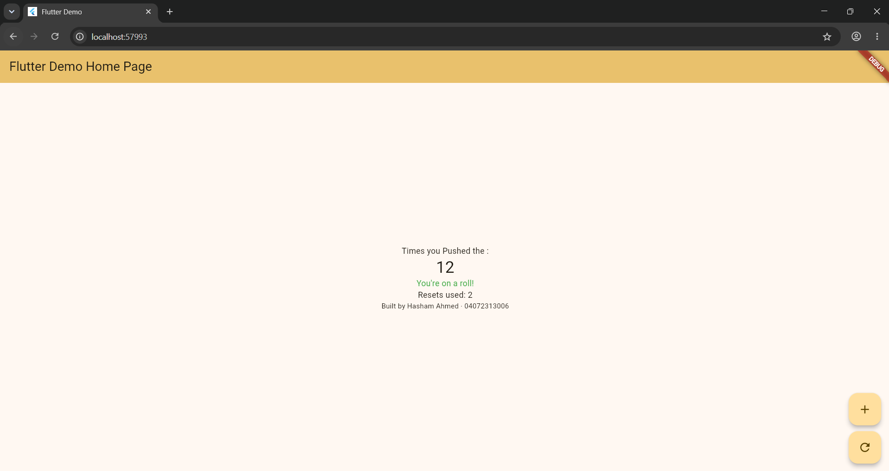

## Written Reflection

I understood that setState() is used when I change something in my app that should also be updated on the screen. Like, when I press the (+) button, the counter changes and setState() asks Flutter to show that new value. If I change the counter without using setState(), Flutter doesn't know that the value changed, so the screen will not update properly.

## SS ATTACEHD.

# flutter_application_1

A new Flutter project.

## Getting Started

This project is a starting point for a Flutter application.

A few resources to get you started if this is your first Flutter project:

- [Learn Flutter](https://docs.flutter.dev/get-started/learn-flutter)
- [Write your first Flutter app](https://docs.flutter.dev/get-started/codelab)
- [Flutter learning resources](https://docs.flutter.dev/reference/learning-resources)

For help getting started with Flutter development, view the
[online documentation](https://docs.flutter.dev/), which offers tutorials,
samples, guidance on mobile development, and a full API reference.
